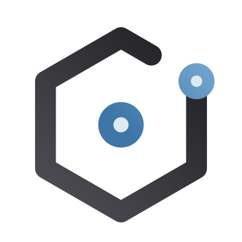

<picture>
  <source media="(prefers-color-scheme: dark)" srcset="https://raw.githubusercontent.com/krizaka/.github/main/profile/assets/krizaka-dark.svg">
  
</picture>

# krizaka/.github

Organisation-wide defaults for every [Krizaka](https://github.com/krizaka) repository:

- `profile/README.md` — the organisation page on GitHub.
- `CONTRIBUTING.md`, `CODE_OF_CONDUCT.md`, `SECURITY.md`, `SUPPORT.md` — community health files,
  used by any repository that does not define its own.
- `.github/ISSUE_TEMPLATE/` and `.github/pull_request_template.md` — default issue forms and PR template.
- `.github/workflows/node-ci.yml`, `java-ci.yml` — the reusable CI of every Node.js / Maven repository; `deploy/` —
  `krizaka-deploy`, the one guarded way to deploy to DigitalOcean App Platform. See [docs/standards/ci-and-deploy.md](docs/standards/ci-and-deploy.md).
- `.github/workflows/krizaka-ci.yml` + `actions/` — the build pack: one line in a repository, the stack detected; `repos.json` — the registry of the org's repositories (generated by `scripts/gen-repos.mjs`).

<!-- krizaka:workflows:start -->
## Workflows

What runs in the Actions tab of this repository.

- **Actions audit** (`actions-audit.yml`): Weekly audit of the actions pinned in every active repository. Runs on a schedule, on demand.
- **App videos** (`app-videos.yml`): Records the download-page videos from the e2e tests and uploads them. Runs called by other workflows.
- **Audit guards** (`audit-guards.yml`): Checks main requires the CI gate and Sonar, and release workflows use an App token. Runs on a schedule, on demand, on every pull request.
- **Automation catalogue** (`automation-catalogue.yml`): Builds and checks the automation catalogue (ADR-026). Runs on every pull request, on push.
- **Sync brand icons** (`brand-icons-sync.yml`): Syncs the brand icons to the sites. Runs when another repository triggers it, on demand, on a schedule.
- **Bump @krizaka packages** (`bump-krizaka.yml`): Opens one auto-merged PR that bumps the @krizaka packages after a release. Runs called by other workflows.
- **Callers report** (`callers-report.yml`): Weekly report of repositories calling shared workflows with an old release. Runs on a schedule, on demand.
- **Changelog rebuild** (`changelog-rebuild.yml`): Rebuilds the krizaka.com changelog when a product releases. Runs when another repository triggers it, on a schedule, on demand.
- **Changed paths** (`changes.yml`): Tells the heavy jobs whether the changed files need them. Runs called by other workflows.
- **CI gate** (`ci-gate.yml`): The single required check of this repository. Runs on every pull request.
- **CLA check** (`cla.yml`): Checks the contributor licence agreement of a pull request. Runs called by other workflows.
- **Code health** (`code-health.yml`): Tests the code-health measuring tool. Runs on every pull request, on push.
- **Conformance** (`conformance.yml`): Checks every repository against the conformance matrix. Runs on a schedule, on every pull request, on demand.
- **Dependabot auto-merge** (`dependabot-automerge.yml`): Auto-merges safe Dependabot updates. Runs called by other workflows, on every pull request.
- **Deploy watch** (`deploy-watch.yml`): Starts a deployment that DigitalOcean missed after a merge. Runs on a schedule, on demand, called by other workflows.
- **Docs are current** (`docs-current.yml`): Checks that the generated docs blocks are up to date. Runs on a schedule, on demand, called by other workflows.
- **Docs map** (`docs-map.yml`): Checks the docs map of the repository. Runs called by other workflows, on every pull request.
- **Expo app CI** (`expo-ci.yml`): The shared CI of an Expo app. Runs called by other workflows.
- **Feature surfaces** (`feature-surfaces.yml`): Reopens a closed feature issue that misses a surface. Runs on a schedule, on demand, called by other workflows.
- **Java CI** (`java-ci.yml`): The shared CI of a Maven repository. Runs called by other workflows.
- **Journey line** (`journey-line.yml`): Reusable: checks a PR names its critical journey. Runs called by other workflows.
- **Critical journeys** (`journeys.yml`): Runs the critical journeys; its gate is a required check. Runs called by other workflows.
- **Krizaka CI** (`krizaka-ci.yml`): The shared CI of any Krizaka repository. Runs called by other workflows.
- **Workflows lint** (`lint-workflows.yml`): Lints the workflow files. Runs called by other workflows, on push, on demand.
- **Maven build and publish** (`maven.yml`): The shared pipeline that builds and publishes the JVM libraries. Runs called by other workflows.
- **Merge resolution** (`merge-resolution.yml`): Fails a PR that drops what main added without a deletion-explained line. Runs called by other workflows, on every pull request.
- **Mobile E2E** (`mobile-e2e.yml`): Maestro flows on an Android emulator. Runs called by other workflows.
- **Node CI** (`node-ci.yml`): The shared CI of a Node.js repository. Runs called by other workflows.
- **CI speed report** (`org-ci-speed.yml`): Reports the CI speed of the org. Runs on a schedule, on demand.
- **Post-deploy journeys** (`post-deploy-journeys.yml`): Reusable: runs the journeys after a deploy. Runs called by other workflows.
- **Post-deploy check** (`post-deploy.yml`): Waits for the live site to serve the new build, then pings IndexNow. Runs called by other workflows.
- **PR cap** (`pr-cap.yml`): Checks the open-PR cap per lane. Runs on a schedule, on demand, called by other workflows, on every pull request.
- **Org profile check** (`profile-check.yml`): Tests the org profile on a PR. Runs called by other workflows.
- **Org profile** (`profile.yml`): Regenerates the org profile. Runs when another repository triggers it, on a schedule, on demand.
- **Propagate workflow pins** (`propagate-pins.yml`): Propagates new shared-workflow pins to the repositories. Runs when a release is published, on a schedule, on demand.
- **Public issues conformance** (`public-issues-conformance.yml`): Checks public issues follow the rules. Runs on a schedule, on demand, called by other workflows.
- **Public issues scan** (`public-issues-scan.yml`): Scans public issues for leaks. Runs on a schedule, when an issue changes, on demand.
- **Python CI** (`python-ci.yml`): The shared CI of a Python project. Runs called by other workflows.
- **Python quality** (`python-quality.yml`): Static quality guards of a Python project. Runs called by other workflows.
- **Release notes** (`release-notes.yml`): Writes the release notes. Runs called by other workflows.
- **Repository registry** (`repos-registry.yml`): Checks the registry of repositories. Runs on a schedule, on demand, called by other workflows.
- **Repository names** (`repository-names.yml`): Checks the repository names. Runs on a schedule, on demand, called by other workflows.
- **Roadmap sync** (`roadmap-sync.yml`): Syncs the roadmap. Runs on a schedule, on demand, called by other workflows.
- **Rust quality** (`rust-quality.yml`): Static quality guards of a Rust crate. Runs called by other workflows.
- **Scorecard** (`scorecard.yml`): OpenSSF Scorecard of the repository. Runs when branch rules change, on a schedule, on demand.
- **Security scan** (`security-scan.yml`): The shared secret and workflow scan. Runs called by other workflows.
- **CI workflows self-test** (`selftest-ci.yml`): Self-tests the shared CI workflows. Runs called by other workflows, on push, on demand.
- **SEO family** (`seo-family.yml`): Daily SEO guard of the family sites. Runs on a schedule, on demand.
- **Stale PRs** (`stale-prs.yml`): Flags stale pull requests. Runs on a schedule, on demand.
- **Mac app (Tauri)** (`tauri-macos.yml`): The shared CI and release of a Tauri macOS app. Runs called by other workflows.
- **Visual regression** (`visual-regression.yml`): The shared pixel-by-pixel comparison of the main journeys. Runs called by other workflows.
- **Weekly digest** (`weekly-digest.yml`): Opens one issue per week listing the releases. Runs on a schedule, on demand.
<!-- krizaka:workflows:end -->
