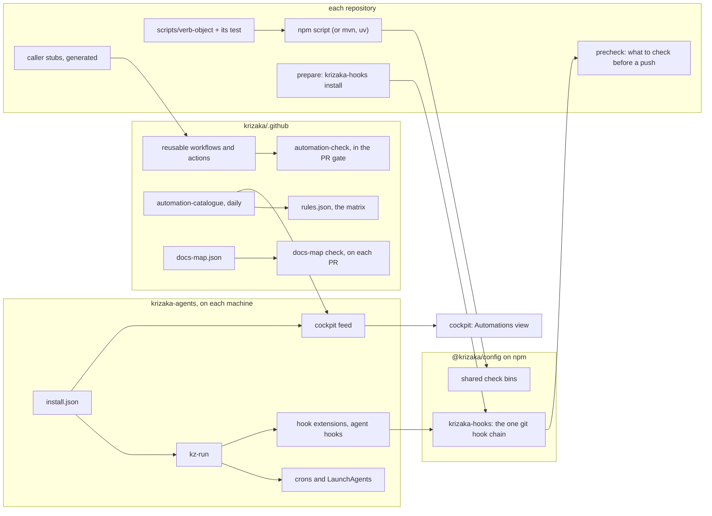

# ADR-026 — Automation strategy: one home per kind, one generated catalogue, checks a person can read

- **Status:** Accepted (founder, 2026-11-06). His three decisions: **one catalogue**, generated daily by the matrix (no file
  committed per repository); **one hook chain**, delivered by the public `@krizaka/config` (not by the private krizaka-agents);
  **phases A, C, E1 and G now**, during the freeze, then B, D and F once it lifts. He added the docs map (§ « The docs map »).
- **Date:** 2026-11-06
- **Issue:** krizaka-internal#2734. **Builds on:** [ADR-013](ADR-013-guards-and-local-sonar.md) (§3 shift-left, §4 one source
  per rule set, §5 less in-house), [ADR-018](ADR-018-workflows-by-concern-profiles-budgets.md) (workflows by concern), the
  conformance matrix ([rules.json](../standards/rules.json), [conformance.md](../standards/conformance.md)).
- **Scope:** every automation of the org: scripts, git hooks, agent hooks, GitHub workflows and composite actions, npm scripts,
  the machine's crons and LaunchAgents, Dockerfile entrypoints. Product code is out of scope.

## Context

The founder's request (2026-11-06, translated): « Clean up and give us a strategy for scripts, crons and the like. They look
scattered across the repositories: I see "pre…" scripts, things with big regexes too hard for a person to follow. We need a clear,
structured plan. »

### How it was measured

`git ls-files` of the 36 reference copies on `main` (2026-11-06, 18:59 UTC). A unit is a script file under `scripts/`, `tools/`,
`bin/`, a hooks folder or an action's code; a workflow, workflow template or composite action; a `package.json` script entry; a
cron, LaunchAgent or agent hook; a Dockerfile entrypoint that runs a script. Regexes are counted from the TypeScript AST (literals
and `new RegExp`) for JS/TS, from Python's `ast` for `re.*`, and from `grep`/`sed`/`awk`/`jq`/`=~` patterns in shell and workflow
`run:` blocks. Callers are resolved from workflows, actions, npm scripts, git hooks, the agents' `install.json`, Dockerfiles,
configs and imports; each workflow's last run comes from the Actions API. Copies are files of the same name that are ≥ 80 % alike line by
line, or files of different names that share ≥ 75 % of their lines. The CSV (one row per unit) and the tool stay in the workspace; phase E makes the tool a
tested part of this repository.

### What exists

| Unit | Count | Notes |
| :-- | --: | :-- |
| Script files | 560 in 22 repos | 71,495 lines: 442 JavaScript, 63 shell, 52 Python, 3 TypeScript |
| GitHub workflows | 305 in 34 repos | 17,330 lines; 72 on a schedule (29 of them the weekly Scorecard); plus 7 templates |
| Composite actions | 25 | 22 in this repository |
| npm script entries | 749 | 596 standard names (`build`, `test`, `lint`…), 153 custom |
| Machine crons | 15 | all in krizaka-agents `install.json`, all through `kz-run` |
| LaunchAgents | 1 | the RunPod guard, installed **outside** `install.json` |
| Agent hooks | 40 | 7 machine-wide (`install.json`), 33 repositories' `.claude/settings.json` (the edit check) |
| Dockerfile entrypoints | 8 | |
| **Total** | **1,717** | |

Script files by kind: 158 CI checks, 142 dev tools, 128 libraries imported by other scripts, 64 generators, 22 deploy steps,
20 crons, 14 git hooks, 7 one-offs, 5 agent hooks. Most units live where the work is: krizaka-ui 236, krizaka-ts 211, this
repository 164, verikora 136, folioviv 133, krizaka-agents 116, sovkora 106, krizaka-com 83; each service repository holds only
its 5–8 workflows.

### What is wrong, in order of cost

1. **Five ways to run a hook, for one job.** (a) The agents' chain: `core.hooksPath` → `tools/githooks/run` (16 symlinks) →
   secret scan, identity guard, `krizaka-precheck`. (b) Four repositories set their own `core.hooksPath` in an npm `prepare`
   (`.githooks/pre-push` in folioviv, verikora and krizaka-ts is byte-identical; krizaka-blog has its own; verikora adds a
   `pre-commit`); the agents' tools then repair the setting at three moments (the commit hook, session start, `pr-open`).
   (c) Six repositories carry a `.pre-commit-config.yaml` (gitleaks, zizmor) that **nothing installs**: no `pre-commit install`
   anywhere, no framework hook in any reference copy. (d) 33 repositories' agent edit hook. (e) The 7 machine-wide agent hooks.
   This is the « pre… » the founder sees.
2. **Copies, although ADR-013 §4 decided « every rule set has one home ».** 20 groups of copied logic, 58 files, about 3,800
   duplicated lines: `check-seo-family.mjs` ×8 next to the `krizaka-seo-family` bin whose own header says « never copied into a
   repository »; `sg-fix.mjs` ×8; `sync-brand-icons.mjs` ×7 (4 of them called by nothing, since the brand-icons fan-out delivers);
   the site release train (`promote-production.mjs`, `production.yml`, `release-please.yml`) ×3; the pre-push hook ×3;
   `runpod-guard.py` ×2 (krizaka-agents and sovkora, 95 % alike); `update-behind-prs.sh`, `publish-packages.sh`,
   `npm-publish-error.mjs`, `check-template-drift.mjs` ×2 each. 14 more are **diverged twins** (same name and job, 35–76 % alike):
   `check-app-links.mjs` ×3, `check-overflow.mjs` ×6 (only folioviv's and verikora's use the shared `@krizaka/page-audit`), the
   folioviv/verikora e2e and visual scripts. sovkora-build ships a second
   `AbstractContainerIntegrationTest` (30 % alike) beside krizaka-test-support's. Separately, 174 files in 11 groups are the
   caller stubs of `workflow-templates/` (dependabot-automerge ×32, merge-resolution ×31, security ×33, scorecard ×30, …):
   GitHub needs one caller file per repository, so these are copies by design, and conformance already writes them.
3. **Things that run for nobody, or that nobody can find.** 44 script files (5,339 lines) are referenced by nothing — no
   workflow, hook, cron, npm script, import or document — 23 directly and 21 only by those; 31 of them changed in the last
   7 days, so many are live manual tools (recordings, demo shops) that only their author knows. 81 more run by hand only (named in
   a document or an npm script nothing calls). 87 custom npm entries are called by nothing. Unused: 3 reusable workflows nobody
   calls (`journey-line.yml`; `post-deploy-journeys.yml`, which the `journeys` rule requires, so that rule cannot pass;
   `maven-github-packages.yml`), 4 actions (`agent-setup` here and `copilot-workspace` in sovkora, left from the coding agent
   dropped on 2026-10-25; `deploy`; `sonar-ratchet`), the 7 pre-commit files. 8 workflows call a reusable workflow or an action
   by a retired repository name and work only through GitHub's redirect.
4. **Big regexes.** 2,453 regexes in 374 units; **84 longer than 80 characters, in 43 files**; the longest single literal is
   367 characters, the longest built expression 714. Of the 84: about 40 are **lists written as one alternation** (issue
   keywords, CDN path allow-lists, ignored folders, error messages), about 20 **parse a structured format** (HTML, `pom.xml`, Java
   and TypeScript source), about 14 are real patterns (commit subjects, legal citations, secret shapes) and about 10 are already
   built from named parts. JS/TS already runs `sonarjs/regex-complexity` and `sonarjs/slow-regex` from `@krizaka/config` under
   the ratchet (ADR-013), which freezes the existing ones; Python and shell have no check at all.
5. **Size.** 51 script files are over 300 lines, 26 over 400. sovkora's `generate-docs.mjs` is 2,803 lines with 271 regexes: it
   reads the Java sources and the database seed with regexes to write 14 documents.
6. **Tests and headers are mostly there.** 98 % of the entry-point scripts open with a header that says why and what; 75 %
   have a test. The gap is 57 untested checks, generators, crons and hooks (27 CI checks, 21 generators, 5 crons, 3 hooks,
   1 deploy step). Headers are prose: no tool can read a trigger or an owner from them, and nothing lists the automations
   in one place.
7. **The machine mostly matches its manifest.** `install.json` holds the 15 crons and 7 hooks, all through `kz-run`; but the
   LaunchAgent is outside it, and the trains cron is paused by a hand-edited comment in the crontab while the manifest says it
   runs. Nothing compares the machine with the manifest. (`wt-new` also refuses the name `.github`, so worktrees of this
   repository are made by hand.)

### The hardest to read

Score = 0.5 × regexes + 3 × regexes over 80 characters + longest regex / 40 + lines / 150 + 2 if untested + 1 if no header.
Copies folded in phase B are left out of this list (they are rewritten once, in their shared home).

| # | Repository | File | Lines | Regexes | > 80 | Longest | Score | What makes it hard |
| --: | :-- | :-- | --: | --: | --: | --: | --: | :-- |
| 1 | sovkora | `scripts/generate-docs.mjs` | 2,803 | 271 | 11 | 160 | 191 | one file for 14 documents; Java read by regex |
| 2 | krizaka-com | `scripts/bunny-layout.mjs` | 482 | 38 | 6 | 714 | 58 | the CDN layout as one built alternation |
| 3 | .github | `scripts/scan-public-issues.mjs` | 148 | 14 | 13 | 269 | 54 | keyword lists as regexes |
| 4 | krizaka-ui | `tools/inventory.mjs` | 455 | 58 | 2 | 139 | 42 | TypeScript source read by regex |
| 5 | sovkora-web | `scripts/codemods/roles.mjs` | 403 | 23 | 6 | 367 | 41 | a finished codemod (phase A deletes it) |
| 6 | krizaka-blog | `scripts/content-rules.mjs` | 567 | 43 | 3 | 125 | 37 | word lists as regexes |
| 7 | krizaka-blog | `scripts/check-meta.mjs` | 179 | 41 | 2 | 108 | 30 | HTML read by regex |
| 8 | .github | `scripts/conformance.mjs` | 674 | 30 | 2 | 87 | 28 | every check type in one file |
| 9 | krizaka-ui | `apps/site/scripts/docs-crawl.mjs` | 479 | 22 | 2 | 223 | 26 | error messages as one regex |
| 10 | .github | `scripts/profile-readme.mjs` | 536 | 27 | 1 | 92 | 22 | version pins read by regex |
| 11 | krizaka-ui | `tools/export-brand.mjs` | 306 | 21 | 2 | 127 | 22 | a path allow-list as one regex |

## Decision

### The principles

1. **One home per kind.** Nothing is copied from one repository to another.

   | Kind | Its one home | Never |
   | :-- | :-- | :-- |
   | A check or generator for several JS repositories | a bin of a published `@krizaka/*` package (today `@krizaka/config`), called by an npm script | a copy in a repository |
   | A CI step for several repositories | a reusable workflow or composite action of krizaka/.github, pinned by SHA | a copied job |
   | The caller file GitHub requires | generated from `workflow-templates/` by conformance (`fix: copy`) | a hand edit |
   | A repository's own check, generator, deploy step or dev tool | its `scripts/` (a package's `scripts/` in a monorepo), the test beside it, run through an npm script (or Maven, uv) | a second folder |
   | Git hooks | the one chain of `@krizaka/config` (`krizaka-hooks install`, run by the repository's `prepare`); the repository says what to check in its `precheck` script | `.githooks/`, husky, a pre-commit configuration |
   | Machine automation: crons, LaunchAgents, machine-wide agent hooks, the machine's hook extensions | krizaka-agents `tools/install.json`, always through `kz-run` | a crontab edit, a hand-made plist |
   | A repository's agent hook | `.claude/settings.json` calling a published bin, no logic | logic in the repository |
   | A one-off (migration, codemod, backfill) | the pull request that runs it; the next one deletes it; git keeps it | a file that stays |

2. **Nothing runs unlisted.** Every unit is a row of one org catalogue generated from the code: what (the header's first
   sentence), where, when (pull request, push, schedule, cron, hook, by hand), called by, owner (the repository's team in
   `repos.json`; the lane for krizaka-agents tools), tests, size, regexes, copies, last run and status. Facts are read, never
   typed. A unit that nothing calls and no document names is deleted.
3. **One job per entry point, at most 400 lines, a header** that says why, what and how to run it (and « manual » when a person
   runs it). The files already over the limit are frozen by a ratchet and split when touched. A tool with subcommands counts one
   job per subcommand (a review rule, not a guard).
4. **Matching a person can read.** A regex over 80 characters is one of three things, and is written as such: a **list** →
   data (a JSON or `as const` array of words or globs) with one matcher; a **structured input** → a parser (the `yaml` package,
   an HTML parser, an XML parser, the TypeScript compiler API or ast-grep, Python's `ast`); a **real pattern** → built from named,
   commented parts, each part tested. The same measure covers JS/TS, Python and shell.
5. **Tested by fixtures.** Every check, generator, deploy step, cron and hook has a test with at least one passing and one
   failing fixture. Dev tools are listed and owned but exempt.
6. **One hook chain, from the public package.** Every repository's `prepare` runs `krizaka-hooks install` (`@krizaka/config`;
   a repository without npm gives the one `npx -y -p @krizaka/config krizaka-hooks install` line in its contributing guide). The
   chain: pre-commit scans the staged diff for secrets, commit-msg checks the co-author trailers against the org's public
   allow-list, pre-push runs the repository's `precheck` npm script. A machine adds its own steps as extensions
   (`~/.config/krizaka/hooks.d/<hook>/`): krizaka-agents installs its secret scan and identity guard there and no longer sets
   `core.hooksPath`. Repositories ship no hook mechanism of their own (no `.githooks/`, husky, `.pre-commit-config.yaml`,
   lefthook). CI stays the last word (ADR-013 §3): a hook only saves time.
7. **The machine matches the manifest.** Every cron, LaunchAgent and machine hook exists only through `install.json`. A pause is
   a field of the manifest (`"paused": "<why, since when>"`) that `install.py` writes as a commented line, never a hand edit. A
   drift check compares the crontab, the LaunchAgents and the agent settings with the manifest and reports in the cockpit.
8. **Guards read the catalogue.** Each principle is a rule of the conformance matrix, ratcheted per repository (the counts only
   go down), plus one pull-request check that refuses a new violation. Nothing here depends on someone remembering it.
9. **The documents follow the change.** A committed docs map says, for each kind of change, which documents it must update
   (newcomer guides, README, AGENTS, skills…); a pull request that makes such a change updates them or says why not.

### Kept, changed, refused

- ✓ **One catalogue generated centrally, not a committed `automation.json` in every repository** (founder, 2026-11-06).
  - → Every fact is readable from the repository at a pinned SHA (the conformance reader already does it). A committed file per
    repository is 33 generated files and 33 staleness checks (one per active repository), and stale generated files already cause about 8 % of our CI reds
    (krizaka-precheck's analysis, krizaka-internal#2607).
  - ! A repository has no catalogue file of its own: `node scripts/automation-catalogue.mjs --repo <path>` prints it on demand.
- ✓ **One hook chain in the public `@krizaka/config`, not in krizaka-agents** (founder, 2026-11-06).
  - → krizaka-agents is private: a contributor could not install it. The package reaches every machine that runs the install.
  - ! The machine's own steps (the central secret scan, the identity guard) become extensions of the chain.
- ✓ **The docs map is committed in krizaka/.github; the local `krizaka.config.json` only points to it** (`docsMap`). → The
  local config is never committed and differs per machine: a list kept there would differ too.
- ✓ **The owner is the repository's team** (`repos.json`) or the krizaka-agents lane, not a tag in every file. → One owner
  per repository is what we have; a tag per file would drift.
- ✓ **Thresholds: 80 characters per regex, 400 lines per file.** → 84 regexes and 26 files are over them today: enough to bite,
  few enough to ratchet. ! Both are one number in the rule, easy to move.
- ✕ **eslint-plugin-regexp.** → `sonarjs/regex-complexity` and `sonarjs/slow-regex` already run in `@krizaka/config`; a second
  plugin adds counters, not readability. The missing piece is a length measure that also covers Python and shell, which the
  catalogue gives.
- ✕ **Tests for every dev tool and seed script.** → They cost more than they save; listing them with an owner is the rule.
- ✕ **A hard size limit now.** → A ratchet freezes the 26 files; phase D rewrites the worst.
- ✕ **Moving the GitHub schedules to the machine.** → The 72 scheduled workflows run without the founder's computer; the
  machine runs only what needs local clones, local state or agent sessions. Both are in the same catalogue.
- ✕ **Renaming every `tools/` folder to `scripts/`.** → Churn without a reader's gain once the catalogue lists everything.
  New files follow the table; old ones move when touched. krizaka-agents `tools/` and this repository's `tools/code-health`
  stay: they are the machine's and the org's tools.
- ✕ **Folding the template caller stubs.** → GitHub requires one caller file per repository.

### Target architecture

**Adding an automation — the path a newcomer follows:**

1. Does it run on the machine, at a time or on an event (cron, LaunchAgent, agent hook, a machine-only hook step)? → krizaka-agents:
   `tools/<verb>-<object>.py` and `tools/<name>.test.py`, an entry in `install.json`, its line in the README (the existing
   `check-tools-documented` guard asks for it), then `install.sh`.
2. Does it apply to two repositories or more? → a check or generator: a bin in `@krizaka/config` with its test and README
   row, released and bumped by `bump-krizaka`, then an npm script in each consumer; a CI step: a reusable workflow or action
   here, with its test in `tests/`. Never a copy.
3. Otherwise → `scripts/<verb>-<object>.mjs` (or `.py`, `.sh`) and `scripts/<name>.test.mjs` with one passing and one failing
   fixture, an npm script, called by `check` or by a workflow; a tool a person runs says « manual » in its header.
4. Something to check before every push? → add it to the repository's `precheck` script; the chain runs it.
5. Open the pull request: update the documents the docs map lists for the change's category (or write « Docs: not needed,
   <why> »); the automation check lists the new catalogue rows in the job summary and refuses a violation.

**How the catalogue is generated:**

- `scripts/automation-catalogue.mjs` (this repository) reads each active repository of `repos.json` at its default branch's SHA
  (the conformance reader), discovers the units by the rules above, resolves their callers, measures them (header, tests,
  lines, regexes through the TypeScript AST, Python's `ast` and the shell patterns, copies by line similarity and content
  hash), adds each workflow's last run, and writes `automation/catalogue.json` (schema `krizaka.automation/1`) and
  `catalogue.md` on the `conformance-matrix` data branch, daily, in the conformance workflow.
- krizaka-agents `tools/cockpit/automation-export.py` (hourly, token-free, like `org-c1.py`) merges it with the machine's part
  (`install.json`, crontab, LaunchAgents, the last run and exit of each `kz-run` log, the drift) into the cockpit's
  `automation.json`. The cockpit shows per repository and kind: what, when, owner, last run, status, with the filters
  unreferenced · copied · untested · long regex · over size.

**How the guards enforce it:**

| Guard | Where | What it refuses or measures |
| :-- | :-- | :-- |
| `automation-check` | an action of this repository, in the shared CI gate, on every pull request | compared with the base: a new copy of an org file or bin; a new unit nothing calls and not marked manual; a new check, generator, deploy step, cron or hook without a test; a new regex over 80 characters not built from parts; a file crossing 400 lines; a hook installer (`core.hooksPath` in `prepare`, `.pre-commit-config.yaml`, `.husky`). The existing debt is not a red. |
| 4 conformance rules | `rules.json`, a new check type `catalogue` | `automation-one-home` (copies), `automation-listed` (unreferenced units), `automation-readable` (regexes over 80, files over 400), `automation-tested` (untested core units): each at most its baseline, lowered by the PR that pays the debt |
| `install.py --check` | krizaka-agents, run by the watchdog cron | the crontab, the LaunchAgents or the agent settings differ from `install.json` |
| Python measure | krizaka-agents complexity guard | regex length and file size in the Python tools (ruff has no such rule) |
| `hook-chain` rule | `rules.json`, with a fan-out fix | a repository whose `prepare` does not run `krizaka-hooks install`, or that ships `.githooks/`, husky or a pre-commit configuration |
| `docs-map` check and rule | a reusable workflow of this repository on every pull request; `rules.json` | a change that matches a category without touching its documents or a « Docs: » line; a repository that does not run the check |

### The docs map

`docs-map.json` (this repository's root, with its schema in `docs/standards/`) lists the kinds of change and, for each, the
documents to update. A category has an id, `when` (repository and globs of the changed files, never regexes, principle 4) and
`docs` (repository and path; `bump` when the document is a krizaka-agents skill, whose plugin version in
`.claude-plugin/marketplace.json` moves with it; `local: true` for a page outside git, such as the cockpit's, printed but never
required). The local `krizaka.config.json` holds only the key `docsMap`, the path of the map in the reference copy, in the
krizaka-agents config schema; tools read the list through it, never from a copy.

| Category | A pull request that touches | Updates |
| :-- | :-- | :-- |
| `way-of-working` | krizaka-agents `tools/`, `skills/`, `subagents/`, `AGENTS.md`; this repository's `docs/standards/` | the four newcomer guides (krizaka-internal `docs/onboarding/`), krizaka-agents README and AGENTS, the skill concerned (plugin version bumped), `AGENTS.template.md` |
| `java-norm` | krizaka-java's parent, test-support and build rules | the `krizaka-java` skill (bumped), the Java section of `AGENTS.template.md`, krizaka-java README |
| `typescript-norm` | krizaka-ts `packages/config/` | the `krizaka-typescript` skill (bumped), `AGENTS.template.md`, the config package README |
| `new-repository` | `repos.json` (a new entry) | the org profile `profile/README.md`, the newcomer guides' repository map, `docs/standards/repositories.md` |
| `product-rename` | `repos.json` names, `@krizaka/org`'s name table | the org profile, the newcomer guides, the products' READMEs, the renames record |
| `automation` | workflows, `scripts/`, `tools/`, krizaka-agents `install.json` | the repository README's automation section; krizaka-agents README « Crons » for machine ones; the guide « with Claude Code » when a session's routine changes |
| `release-process` | release-please files, release workflows, `release-repos.json`, `bump-krizaka` | `docs/standards/ci-and-deploy.md`, the repository's RELEASING or README, the `krizaka-landing` skill (bumped) |
| `board-lanes` | krizaka-agents `tools/lanes/`, the board tools, the statuses and lanes of `kz.py` | the `krizaka-lane-session` and `krizaka-issue` skills (bumped), the newcomer guides, `LABELS.md` |

The guard: on each pull request, for each category its changed files match, a listed document of the same repository is in
the diff, or the body has « Docs: <the pull request or issue that updates them> » (a document of another repository), or
« Docs: not needed, <why> ». The check has fixtures for every form; a conformance rule makes every active repository run it.

## Consequences

- ✓ One answer to « what runs, where, when, who owns it, did it work »: the cockpit view, read from the code.
- ✓ A fix to an org check lands once and reaches every repository by a version bump, as ADR-013 meant.
- ✓ One hook mechanism instead of five; the « repair » paths of the agents' chain go away.
- ✓ The regex debt stops growing at once (phase F) and shrinks where it costs most (phase D).
- ! Every change to a shared check becomes a release of `@krizaka/config` or a new SHA of this repository; consumers wait for
  the bump.
- ✓ A change of a given kind always updates the same documents; a newcomer's guide stays true.
- ! A machine that skipped the install (or a repository without npm whose contributor skipped the `npx` line) pushes without
  local checks; CI still refuses what is wrong.
- ! A pull request that matches a category carries a « Docs: » line when it does not touch the documents.
- ! The catalogue's discovery rules are heuristics (callers by name and path); a wrong « unreferenced » is fixed by naming the
  tool in its repository's README, never by an exception list.
- ✕ Refused: copies kept « identical by hand », a per-file owner tag, a second regex lint plugin, a repository's own hook
  mechanism, a docs list kept in a local config.

## Plan

Phases in order of value. Each line is one issue (one repository, one theme); S is under half a day, M up to two days, L more.
Every issue's « Done when » includes: **the documents of the docs map for this category are updated (newcomer guides,
README, AGENTS, skills)**.

Timing (founder, 2026-11-06): **A, C, E1 and G now**, during the freeze; **B, D and F once it lifts**. The issues of A, C, E1
and G are filed as children of krizaka-internal#2734; the others are filed when their phase opens. Per repository they group
into delivery blocks.

### A — delete what runs for nobody (8 issues)

| # | Repository | Issue | Size |
| :-- | :-- | :-- | :-- |
| A1 (krizaka-internal#2735) | .github | remove the unused actions (`agent-setup`, `deploy`, `sonar-ratchet`), `maven-github-packages.yml` and the copy of `update-behind-prs.sh` | S |
| A2 (krizaka-internal#2736) | .github | `journey-line.yml` and `post-deploy-journeys.yml`: adopt them in the three apps the `journeys` rule names (folioviv, verikora, sovkora-web), or drop them with the rule's clause | S |
| A3 (krizaka-internal#2737) | sovkora | remove the `copilot-workspace` action; triage the 5 unreferenced scripts; call the desktop film action by the repository's current name | S |
| A4 (krizaka-internal#2738) | folioviv | triage the 13 unreferenced scripts (recordings, demo shop): delete, or mark manual and name them in the README | S |
| A5 (krizaka-internal#2739) | verikora | the same, 6 scripts | S |
| A6 (krizaka-internal#2740) | sovkora-web | the same, 3 scripts; delete the finished codemod `scripts/codemods/roles.mjs` | S |
| A7 (krizaka-internal#2741) | sovkora-mobile | the same, 4 scripts (among them a 384-line `check-app-links.mjs` nothing runs) | S |
| A8 (krizaka-internal#2742) | krizaka-ui | the same, 4 files (brand-film orphans, an unused `sync-brand-icons.mjs`) | S |

### B — fold the copies into their one home (18 issues)

| # | Repository | Issue | Size |
| :-- | :-- | :-- | :-- |
| B1 | krizaka-ts | `krizaka-sg-fix` bin in `@krizaka/config` (8 copies of `sg-fix.mjs`) | S |
| B2 | .github | one reusable site release (release-please, production branch, promotion) for the three site repositories | M |
| B3 | .github | one `check-app-links` action for the web and mobile apps (3 diverged copies) | M |
| B4 | krizaka-ts | `@krizaka/page-audit` takes what the four other `check-overflow.mjs` still add (ADR-013 §5); folioviv and verikora already use it | S |
| B5 | .github | one npm publish action (`publish-packages.sh`, `npm-publish-error.mjs` of krizaka-ts and krizaka-ui) | M |
| B6 | sovkora-build | the services extend krizaka-test-support's `AbstractContainerIntegrationTest`; the second base goes | M |
| B7–B18 | kridoc, krizaka-blog, krizaka-com, krizaka-coming-soon, krizaka-template-web, krizaka-java, krizaka-ts, krizaka-ui, krizaka-lab, sovkora-web, folioviv, verikora | one issue per repository: call the shared bins and workflows (B1–B5, `krizaka-seo-family`, the visual-regression workflow), delete its copies and its unused `sync-brand-icons.mjs` | S each (M for krizaka-com) |

### C — machine automation through krizaka-agents, one hook chain (12 issues)

| # | Repository | Issue | Size |
| :-- | :-- | :-- | :-- |
| C1 (krizaka-internal#2743) | krizaka-agents | LaunchAgents in `install.json` (the RunPod guard), installed and removed by `install.py` | S |
| C2 (krizaka-internal#2744) | krizaka-agents | a pause is a field of `install.json`; the trains cron's hand edit becomes it | S |
| C3 (krizaka-internal#2745) | krizaka-agents | `install.py --check`: drift of the crontab, LaunchAgents and agent settings, run by the watchdog | M |
| C4 (krizaka-internal#2746) | krizaka-ts | the `krizaka-hooks` bin in `@krizaka/config`: the one chain (secret scan, trailers, `precheck`, machine extensions) | M |
| C5 (krizaka-internal#2747) | krizaka-agents | the agents' hooks become extensions of the chain; no tool sets or repairs `core.hooksPath`; `wt-new` accepts `.github` | M |
| C6 (krizaka-internal#2748) | .github | the `hook-chain` rule and its fan-out (`prepare` runs `krizaka-hooks install`; the pre-commit files of krizaka-com, krizaka-ui and sovkora-web go) | M |
| C7 (krizaka-internal#2749) | folioviv | `.githooks/` becomes a `precheck` script; `prepare` installs the chain; the pre-commit file goes | S |
| C8 (krizaka-internal#2750) | verikora | the same (pre-commit and pre-push) | S |
| C9 (krizaka-internal#2751) | krizaka-ts | the same | S |
| C10 (krizaka-internal#2752) | krizaka-blog | the same | S |
| C11 (krizaka-internal#2753) | .github | delete `.pre-commit-hooks.yaml` and its root-layout entry | S |
| C12 (krizaka-internal#2754) | sovkora | drop `scripts/runpod-guard.py`; call the krizaka-agents guard | S |

The 7 `uses:` that still name Sovkora's retired code name are caught by the code-name sweep (krizaka-internal#2659): no issue
of their own.

### D — rewrite the ten hardest to read (10 issues)

| # | Repository | File | Rewrite | Size |
| :-- | :-- | :-- | :-- | :-- |
| D1 | sovkora | `scripts/generate-docs.mjs` | one generator per document behind one runner; Java facts through ast-grep or a Java parser | L |
| D2 | krizaka-com | `scripts/bunny-layout.mjs` | the layout as data (globs per prefix) and one matcher | M |
| D3 | .github | `scripts/scan-public-issues.mjs` | keyword lists as data, a word matcher | S |
| D4 | krizaka-ui | `tools/inventory.mjs` | the TypeScript compiler API for exports and imports | M |
| D5 | krizaka-blog | `scripts/content-rules.mjs` | word lists as data, one rule per module | M |
| D6 | krizaka-blog | `scripts/check-meta.mjs` | an HTML parser | S |
| D7 | .github | `scripts/conformance.mjs` | one module per check type | M |
| D8 | krizaka-ui | `apps/site/scripts/docs-crawl.mjs` | the error messages as a list | S |
| D9 | .github | `scripts/profile-readme.mjs` | the manifests through their parsers | M |
| D10 | krizaka-ui | `tools/export-brand.mjs` | the allow-list as globs | S |

### E — the catalogue and the cockpit view (3 issues)

| # | Repository | Issue | Size |
| :-- | :-- | :-- | :-- |
| E1 (krizaka-internal#2755) | .github | `scripts/automation-catalogue.mjs`, its schema, fixtures and the daily publication | L |
| E2 | krizaka-agents | `tools/cockpit/automation-export.py`: the org catalogue plus the machine's part | M |
| E3 | the cockpit | the « Automations » view (per repository and kind; filters; last run and status) | M |

### F — the guards (4 issues)

| # | Repository | Issue | Size |
| :-- | :-- | :-- | :-- |
| F1 | .github | `actions/automation-check` in the shared CI gate (new violations only) | M |
| F2 | .github | the check type `catalogue` and the four `automation-*` rules, with their baselines | M |
| F3 | krizaka-agents | regex length and file size for the Python tools in the complexity guard | S |
| F4 | krizaka-ts | `scripts/` and `tools/` inside the shared ESLint layer of every consumer (the sonarjs regex rules then cover them) | S |

### G — the docs map (6 issues)

| # | Repository | Issue | Size |
| :-- | :-- | :-- | :-- |
| G1 (krizaka-internal#2756) | .github | `docs-map.json`, its schema and `docs/standards/docs-map.md`, the eight categories | S |
| G2 (krizaka-internal#2757) | krizaka-agents | the `docsMap` key in the config schema and example, read by `kz-config` (points to the map) | S |
| G3 (krizaka-internal#2758) | .github | the `docs-map` check: reusable workflow, caller template, `scripts/docs-map-check.mjs` with fixtures | M |
| G4 (krizaka-internal#2759) | .github | the `docs-map` rule (every active repository runs the check; required in the profile) | S |
| G5 (krizaka-internal#2760) | krizaka-agents | `pr-open` lists the documents for the change and wants a « Docs: » line when none is touched | S |
| G6 (krizaka-internal#2761) | krizaka-internal | the four newcomer guides explain the docs map, the hook chain and the catalogue | S |

61 issues: 40 S, 19 M, 2 L. Done when the `automation-*`, `hook-chain` and `docs-map` rules pass in every active repository
and the cockpit view shows no unreferenced, copied or untested core unit outside its baseline.
