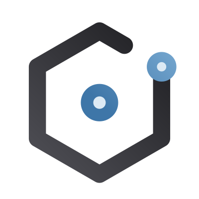

<picture>
  <source media="(prefers-color-scheme: dark)" srcset="assets/krizaka-dark.svg">
  
</picture>

# Krizaka

### Know-how, in the open.

We build what others take years to get right — and show it running. Three things we know how to do, each proven by a
product; the stack under them, open source.

[Website](https://www.krizaka.com) · [Products](https://www.krizaka.com/en/products) · [Open source](https://www.krizaka.com/en/open-source) · [Roadmap](https://github.com/orgs/krizaka/projects/4) · [Contact](https://www.krizaka.com/en/contact)

## What we know how to do

Each product stands on its own; each proves one skill. Claims are cheap — every line below is read from the repositories, the registries and the health checks, never typed.

<!-- generated:start — scripts/profile-readme.mjs reads this from the registries and the health checks; do not edit -->
<table>
<tr><td valign="top" width="64"><picture><source media="(prefers-color-scheme: dark)" srcset="https://krizaka-assets.b-cdn.net/brand/sovkora/mark-dark.svg?v=5adc3bcf5f"></picture></td><td valign="top">

**Sovkora** · The engine &nbsp;In development · sign-up closed Every request crosses a deterministic pipeline to the best local model: your documents, your models, your network — nothing leaves. [Repository](https://github.com/krizaka/sovkora) ·  · 

Components (16): clients, backend-for-frontend, services, workers · green is the latest, orange has a newer one

**Clients: web**

| Component | Language | Repository | Krizaka modules (used) |
| :--- | :--- | :--- | :--- |
| Web client |  | [sovkora](https://github.com/krizaka/sovkora/tree/HEAD/apps/web) | npm (16)                 |

**Clients: mobile**

| Component | Language | Repository | Krizaka modules (used) |
| :--- | :--- | :--- | :--- |
| Mobile client |   | [sovkora](https://github.com/krizaka/sovkora/tree/HEAD/apps/mobile) | npm (12)             |

**Clients: Mac**

| Component | Language | Repository | Krizaka modules (used) |
| :--- | :--- | :--- | :--- |
| Mac app |   | [sovkora](https://github.com/krizaka/sovkora/tree/HEAD/apps/desktop) | npm (8)         Rust (1)  |

**Clients: command line**

| Component | Language | Repository | Krizaka modules (used) |
| :--- | :--- | :--- | :--- |
| CLI |  | [sovkora](https://github.com/krizaka/sovkora/tree/HEAD/apps/cli) | npm (1)  |

**Backend for frontend (the web app's server side)**

| Component | Language | Repository | Krizaka modules (used) |
| :--- | :--- | :--- | :--- |
| Web BFF |  | [sovkora](https://github.com/krizaka/sovkora/tree/HEAD/apps/web/src/app/api) | — |

**Services**

| Component | Language | Repository | Krizaka modules (used) |
| :--- | :--- | :--- | :--- |
| Edge |  | [sovkora](https://github.com/krizaka/sovkora/tree/HEAD/services/edge) | Maven (1)  |
| Conversation |  | [sovkora](https://github.com/krizaka/sovkora/tree/HEAD/services/conversation) | Maven (9)          |
| Jobs |  | [sovkora](https://github.com/krizaka/sovkora/tree/HEAD/services/job) | Maven (5)      |
| Knowledge |  | [sovkora](https://github.com/krizaka/sovkora/tree/HEAD/services/knowledge) | Maven (2)   |
| Automation |  | [sovkora](https://github.com/krizaka/sovkora/tree/HEAD/services/automation) | Maven (3)    |
| Studio |  | [sovkora](https://github.com/krizaka/sovkora/tree/HEAD/services/studio) | Maven (4)     |
| AI engine |  | [sovkora](https://github.com/krizaka/sovkora/tree/HEAD/engine) | Maven (3)    |

**Workers**

| Component | Language | Repository | Krizaka modules (used) |
| :--- | :--- | :--- | :--- |
| Media and GPU worker |  | [sovkora](https://github.com/krizaka/sovkora/tree/HEAD/workers/media) | — |
| Packs |   | [sovkora](https://github.com/krizaka/sovkora/tree/HEAD/packs) | npm (1)  |

**Shared libraries and build**

| Component | Language | Repository | Krizaka modules (used) |
| :--- | :--- | :--- | :--- |
| Contracts |  | [sovkora](https://github.com/krizaka/sovkora/tree/HEAD/contracts) | — |
| Build and BOM |  | [sovkora](https://github.com/krizaka/sovkora/tree/HEAD/build) | Maven (2)   |

</td></tr>
<tr><td valign="top" width="64"><picture><source media="(prefers-color-scheme: dark)" srcset="https://krizaka-assets.b-cdn.net/brand/verikora/mark-dark.svg?v=c4fbf96eee"></picture></td><td valign="top">

**Verikora** · Reading documents &nbsp;In development · sign-up closed A lease checked rule by rule against the law in force on a date, a PDF examined for signs of editing: every finding quotes its passage, every check is a traced engine run. [Repository](https://github.com/krizaka/verikora) ·  · 

Components (5): clients, backend-for-frontend, services, workers · green is the latest, orange has a newer one

**Clients: web**

| Component | Language | Repository | Krizaka modules (used) |
| :--- | :--- | :--- | :--- |
| Web app |  | [verikora](https://github.com/krizaka/verikora/tree/HEAD/apps/web) | npm (29)                              |

**Clients: mobile**

| Component | Language | Repository | Krizaka modules (used) |
| :--- | :--- | :--- | :--- |
| Mobile app |  | [verikora](https://github.com/krizaka/verikora/tree/HEAD/apps/mobile) | npm (9)          |

**Clients: Mac**

| Component | Language | Repository | Krizaka modules (used) |
| :--- | :--- | :--- | :--- |
| Mac app |   | [verikora](https://github.com/krizaka/verikora/tree/HEAD/apps/desktop) | npm (8)         Rust (1)  |

**Backend for frontend (the web app's server side)**

| Component | Language | Repository | Krizaka modules (used) |
| :--- | :--- | :--- | :--- |
| API routes |  | [verikora](https://github.com/krizaka/verikora/tree/HEAD/apps/web/app/api) | — |

**Shared libraries and build**

| Component | Language | Repository | Krizaka modules (used) |
| :--- | :--- | :--- | :--- |
| Shared packages |  | [verikora](https://github.com/krizaka/verikora/tree/HEAD/packages) | npm (2)   |

</td></tr>
<tr><td valign="top" width="64"><picture><source media="(prefers-color-scheme: dark)" srcset="https://krizaka-assets.b-cdn.net/brand/folioviv/mark-dark.svg?v=8268ecf1bf"></picture></td><td valign="top">

**Folioviv** · Running a shop, for less &nbsp;In development · sign-up closed Bookings, bilingual invoices with GST and QST to the cent and a ledger the database keeps balanced, for independent Québec shops; the GST/QST return is prepared, and the merchant files it. [Repository](https://github.com/krizaka/folioviv) ·  · 

Components (5): clients, backend-for-frontend, services, workers · green is the latest, orange has a newer one

**Clients: web**

| Component | Language | Repository | Krizaka modules (used) |
| :--- | :--- | :--- | :--- |
| Web app |  | [folioviv](https://github.com/krizaka/folioviv/tree/HEAD/apps/web) | npm (24)                         |

**Clients: mobile**

| Component | Language | Repository | Krizaka modules (used) |
| :--- | :--- | :--- | :--- |
| Mobile app |  | [folioviv](https://github.com/krizaka/folioviv/tree/HEAD/apps/mobile) | npm (9)          |

**Clients: Mac**

| Component | Language | Repository | Krizaka modules (used) |
| :--- | :--- | :--- | :--- |
| Mac app |  | [folioviv](https://github.com/krizaka/folioviv/tree/HEAD/apps/desktop) | Rust (1)  |

**Backend for frontend (the web app's server side)**

| Component | Language | Repository | Krizaka modules (used) |
| :--- | :--- | :--- | :--- |
| API routes |  | [folioviv](https://github.com/krizaka/folioviv/tree/HEAD/apps/web/app/api) | — |

**Shared libraries and build**

| Component | Language | Repository | Krizaka modules (used) |
| :--- | :--- | :--- | :--- |
| Shared packages |  | [folioviv](https://github.com/krizaka/folioviv/tree/HEAD/packages) | npm (15)                |

</td></tr>
</table>

## The open stack

What the products are built on, published for anyone to use. The versions are the latest published, read when this page was last generated.

| Package | Latest |
| :--- | :--- |
| **[Krizaka UI](https://ui.krizaka.com)**: components, tokens, icons and charts, web and React Native |  |
| **[Krizaka Java](https://java.krizaka.com)**: Spring Boot building blocks, published to GitHub Packages |  |
| **[Krizaka TS](https://ts.krizaka.com/)**: TypeScript backend building blocks on npm: accounts and roles, settings, API keys, webhooks, organizing, the weekly brief |   |
| **[Krizaka Lab](https://lab.krizaka.com/)**: the family's lab for UI, motion, Java, AI and data experiments; nothing here is a product (motion.krizaka.com redirects here) |  |
<!-- generated:end -->

## Code quality

Every repository is analysed by [SonarCloud](https://sonarcloud.io/organizations/krizaka/projects): reviews focus on what a change does, its architecture and its elegance, and Sonar checks the code and its coding rules. Coverage joins this board as each repository's CI reports it.

<!-- quality:start -->
| | Repository | Analysis |
| :--- | :--- | :--- |
| Products | [verikora](https://github.com/krizaka/verikora) |       |
|  | [folioviv](https://github.com/krizaka/folioviv) |       |
|  | [sovkora](https://github.com/krizaka/sovkora) |       |
| Building blocks | [krizaka-ui](https://github.com/krizaka/krizaka-ui) |       |
|  | [krizaka-ts](https://github.com/krizaka/krizaka-ts) |       |
|  | [krizaka-java](https://github.com/krizaka/krizaka-java) |       |
| Sites | [krizaka-com](https://github.com/krizaka/krizaka-com) |       |
|  | [krizaka-blog](https://github.com/krizaka/krizaka-blog) |       |
<!-- quality:end -->

## Naming

Product and shared repository names follow [one standard](https://github.com/krizaka/.github/blob/main/docs/standards/repositories.md).

## Get involved

[Contributing](https://github.com/krizaka/.github/blob/main/CONTRIBUTING.md) · [Code of conduct](https://github.com/krizaka/.github/blob/main/CODE_OF_CONDUCT.md) · [Report a vulnerability, privately](https://github.com/krizaka/.github/blob/main/SECURITY.md) · [Support](https://github.com/krizaka/.github/blob/main/SUPPORT.md)

Made in Montréal. The products and the open stack above are generated daily by [`scripts/profile-readme.mjs`](https://github.com/krizaka/.github/blob/main/scripts/profile-readme.mjs) from [`profile/products.json`](https://github.com/krizaka/.github/blob/main/profile/products.json).
